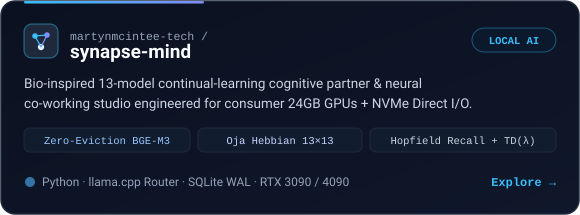

  

 

### Featured Open-Source Engineering

  &nbsp;&nbsp;

  &nbsp;&nbsp;

  &nbsp;&nbsp;

  
<strong>🕹️ Peek Inside — LCP 2026 Live Showcase — 3-Story House, EV Car Commute, Greggs, Pub, Club SID &amp; Glass Knock (480×480)</strong>

   
  

    
    
<em>Rendered in Pepto's authentic 16-color VIC-II palette at ~0.23 ms/frame and pushed over persistent HTTP/1.1 keep-alive to an iCUE LINK System Hub on Linux.</em>

  

 

### Systems & Architecture Stack

  

 

### Current Engineering Focus

- **Single-GPU Cognitive Architectures ([`synapse-mind`](https://github.com/martynmcintee-tech/synapse-mind) & [`linux-ai-vram-guard`](https://github.com/martynmcintee-tech/linux-ai-vram-guard))** — Orchestrating 13 specialized local GGUF models on 24GB GDDR6X silicon with NVMe Direct I/O (`~8.8s` cold 32B swaps), CPU-pinned `BGE-M3` embeddings for zero VRAM eviction, Oja's normalized Hebbian plasticity, and automatic idle CUDA memory reclamation across `llama.cpp` and `ComfyUI`.
- **Native Linux Hardware & Creator Tooling ([`elgato-camera-hub-linux`](https://github.com/martynmcintee-tech/elgato-camera-hub-linux), [`corsair-titan-lcd-linux`](https://github.com/martynmcintee-tech/corsair-titan-lcd-linux) & [`openlinkhub-gtk-control-center`](https://github.com/martynmcintee-tech/openlinkhub-gtk-control-center))** — Replacing heavyweight Windows-only vendor suites with native GTK4/Libadwaita studios, direct kernel V4L2 `ioctl` controls alongside live PipeWire streams, gamma-2.4 PWM LED calibration, and wall-clock phase-locked `480×480` circular HUDs.
- **Offline-First Desktop & Spatial Computing ([`loseit-local`](https://github.com/martynmcintee-tech/loseit-local))** — Local SQLite desktop applications with full data ownership and optional local Vision/LLM pipelines, alongside standalone 90Hz OpenXR simulations on Meta Quest 3 (Godot 4 + Blender LTS OptiX).
