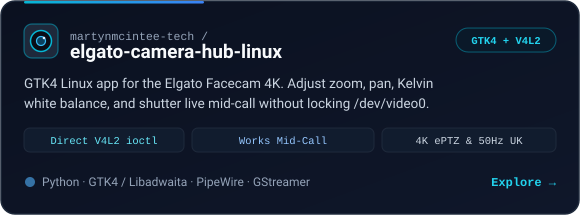
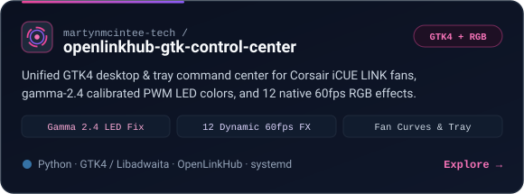
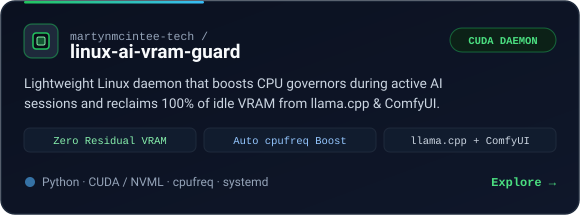
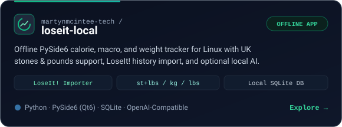
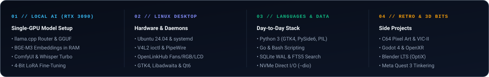

  

 

Hi, I'm Martyn. I moved my main PC from Windows to Ubuntu 24.04 and got fed up not having proper Linux apps for bits of hardware sitting on my desk - mainly my Corsair iCUE LINK watercooler screen, case fans, and Elgato Facecam 4K. Most of what's here started out as me writing the missing GTK4/Qt desktop tools and small `systemd` daemons so my own setup works the way I want without booting back into Windows.

The rest is local AI tooling for my 24GB RTX 3090 (keeping `llama.cpp`, `ComfyUI`, and CPU-side embeddings from fighting over the same 24 gigs of VRAM), an offline Linux replacement for the LoseIt! calorie tracker with proper UK stones-and-pounds support, and a 2026 tribute to Activision's 1985 Commodore 64 *Little Computer People* living inside my circular cooler LCD.

### Projects

  &nbsp;&nbsp;

  &nbsp;&nbsp;

  &nbsp;&nbsp;

  
<strong>Little Computer Person running on my Corsair TITAN 360 RX cooler (live camera clip + 480x480 feed)</strong>

   
  

    &nbsp;&nbsp;
    
<em>Grew up wasting hours on Activision's 1985 C64 Little Computer People as a kid and wanted the little fella living inside my circular watercooler screen. Drawn in Pepto's 16-colour VIC-II palette and pushed to OpenLinkHub over persistent HTTP/1.1 keep-alive.</em>

  

 

### Desk Setup & Usual Tools

  

 

*Note: I build these for my own Ubuntu desktop with AI coding tools helping out on UI boilerplate, math, and protocol plumbing, and everything is tested on the actual hardware sitting on my desk. All public repos here are MIT licensed - if you've got the same kit on Linux, help yourself.*
