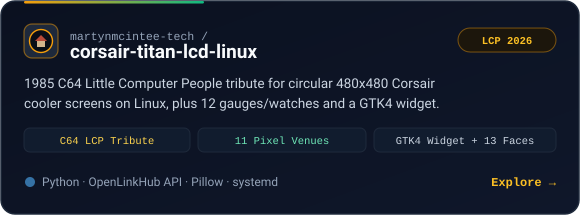

  

 

### Featured Open-Source Engineering

  &nbsp;&nbsp;

  
<strong>🕹️ Peek Inside — Autonomous 1985 C64 <em>Little Computer People</em> Cutaway House Running on a 480×480 Cooler LCD</strong>

   
  

    
    
<em>Rendered in Pepto's authentic 16-color VIC-II palette at ~0.23 ms/frame and pushed over persistent HTTP/1.1 keep-alive to an iCUE LINK System Hub on Linux.</em>

  

 

### Systems & Architecture Stack

  

 

### Current Engineering Focus

- **Single-GPU Cognitive Architectures ([`synapse-mind`](https://github.com/martynmcintee-tech/synapse-mind))** — Orchestrating 13 specialized local GGUF models on 24GB GDDR6X silicon with NVMe Direct I/O (`~8.8s` cold 32B swaps), CPU-pinned `BGE-M3` embeddings for zero VRAM eviction, Oja's normalized Hebbian plasticity, and modern continuous Hopfield recall.
- **Native Linux Hardware & Telemetry ([`corsair-titan-lcd-linux`](https://github.com/martynmcintee-tech/corsair-titan-lcd-linux))** — Replacing heavyweight Windows-only vendor suites with deterministic Python/Go `systemd` daemons, gamma-calibrated PWM LED curves, wall-clock phase-locked `480×480` circular HUDs, and OpenLinkHub integrations.
- **Spatial Computing & Autonomous Simulations** — Building standalone 90Hz OpenXR training environments on Meta Quest 3 (Godot 4 + Blender LTS OptiX) alongside procedural retro state-machine engines.
